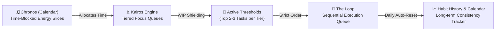

# ⏳ KAIROS (καιρός)

> **"Chronos tells you *when*. Kairos tells you *what*."**  
> *Kairos* is an intentional task and habit planning system designed to eliminate decision fatigue, enforce work-in-progress (WIP) limits, and harmonize seamlessly with time-blocked calendar scheduling.

---

[](https://flutter.dev)
[](https://dart.dev)
[](https://m3.material.io)
[]()
[]()

---

## 🏛️ The Kairos Philosophy

In classical Greek, **Chronos** (χρόνος) refers to quantitative, sequential time—the minutes and hours that tick on your clock and calendar. **Kairos** (καιρός) signifies the *right, critical, or opportune moment*—the qualitative time for decisive action.

Most productivity systems fail because they treat all tasks as a sprawling, overwhelming list without regard to attention limits or calendar realities. **Kairos** bridges this gap:



---

## ⚖️ The 60 / 25 / 15 Calendar Framework

Kairos is engineered to work hand-in-hand with **Google Calendar** (or any time-blocking tool). Rather than scheduling individual micro-tasks on your calendar, schedule **Tier Blocks**, and let Kairos drive execution during that block.

| Tier | Name | Target Time | Focus Type | Purpose & Scope |
| :---: | :---: | :---: | :---: | :--- |
| **S** | **S-Tier** *(Blue)* | **~60%** | **Deep Work / Game-Changers** | High-leverage, mission-critical projects that move the needle. Non-negotiable focus. |
| **A** | **A-Tier** *(Green)* | **~25%** | **High-Impact / Sustaining** | Core secondary objectives, essential recurring workflows, skill building, and maintenance. |
| **B** | **B-Tier** *(Yellow)* | **~15%** | **Hygiene / Quick Wins** | Administrative tasks, lightweight chores, communication, and housekeeping. |

> [!TIP]
> **Suggested Calendar Split for an 8-Hour Workday:**
> - **S-Tier:** 4.5 – 5.0 hours (e.g., Morning uninterrupted deep focus)
> - **A-Tier:** 2.0 hours (e.g., Mid-afternoon high-priority projects)
> - **B-Tier:** 1.0 – 1.5 hours (e.g., Late afternoon clearing of admin and light tasks)

---

## ✨ Key Features

### 1. 🎯 Dynamic Tiered Lists (S, A, B)
- **Independent Priority Ranking:** Tasks within each tier maintain their own 1..*N* rank.
- **Drag-and-Drop Reordering:** Fluid reordering using Material 3 `ReorderableListView`.
- **Seamless Reassignment:** Quickly move tasks between S, A, and B via the context menu.

### 2. 🛡️ Active Thresholds (WIP Limits)
- Prevent cognitive overload by hiding the back-log from your active focus.
- Configure individual threshold counts for each tier (e.g., top 2 in S, top 3 in A, top 2 in B).
- Tasks ranked within your threshold are labeled **ACTIVE**; remaining tasks wait gracefully in your pipeline until an active slot opens.

### 3. 🔁 The Loop (Strict Sequential Queue)
- A consolidated view presenting only your **Active** tasks across all tiers.
- **Strict Sequential Discipline:** Within each tier, only the **first pending task** can be marked complete. This prevents "task shopping" and ensures your highest-priority item gets finished first.
- Completed tasks immediately yield priority to the next item in the rotation.

### 4. 📅 Habit Tracking & Historical Heatmaps
- Tap any task to open its **Habit Details Dialog**.
- Features an interactive month-by-month calendar view displaying exact completion dates.
- Interactive date toggling lets you inspect past consistency or backfill missed entries.
- Displays total completed day tallies over time.

### 5. 🌅 Automatic Daily Reset
- Tasks completed today automatically reset at midnight (or upon reopening the app on a new day), keyed cleanly by `yyyy-MM-dd`.
- Perfect for recurring daily habits, rituals, and continuous iterative work.

### 6. 🎨 Material 3 Expressive UI
- Modern aesthetic powered by **Google Fonts (Plus Jakarta Sans)**.
- Real-time date and time indicator in the app bar.
- One-click **Dark Mode / Light Mode** toggle with auto-saved preference.

### 7. 💾 Zero Lock-in Data Portability (JSON)
- Automatic local persistence using `SharedPreferences`.
- One-click **Export to JSON** and **Import from JSON**.
- Fully supported across **Web** (native browser download & file picker) and **Desktop/Mobile**.

---

## 🚀 Getting Started

### Prerequisites
- [Flutter SDK](https://docs.flutter.dev/get-started/install) `^3.12` / `^3.44`
- [Dart SDK](https://dart.dev/get-dart) `^3.12`
- Supported Web Browser (Chrome, Edge, Firefox) or Native Platform Toolchain (Windows/macOS/Linux/Android/iOS)

### Installation & Launch

1. **Clone the repository:**
   ```bash
   git clone https://github.com/<your-username>/task-planner.git
   cd task-planner
   ```

2. **Fetch dependencies:**
   ```bash
   flutter pub get
   ```

3. **Run on your target platform:**
   ```bash
   # Launch on Chrome (Web)
   flutter run -d chrome

   # Launch on Desktop (Windows)
   flutter run -d windows

   # Launch on connected mobile device or emulator
   flutter run
   ```

4. **Build for production:**
   ```bash
   # Production Web build
   flutter build web --release

   # Windows desktop executable
   flutter build windows --release
   ```

---

## 📋 Recommended Daily Workflow

```mermaid
sequenceDiagram
    autonumber
    actor User as You
    participant Cal as Google Calendar
    participant App as Kairos
    participant Loop as Loop Execution

    User->>Cal: Check current block (e.g., S-Tier Block: 9am-12pm)
    User->>App: Open Kairos
    User->>App: Configure Thresholds (e.g., S: 2, A: 2, B: 2)
    User->>Loop: Open "Loop" Tab
    Loop-->>User: Displays active top-priority task
    User->>Loop: Execute & Check off completed task
    Loop-->>App: Advances next pending task into active slot
    App-->>User: Daily reset refreshes tasks at midnight
```

1. **Morning Alignment:** Set up your Google Calendar blocks (60% S, 25% A, 15% B).
2. **Log & Rank:** Add all tasks into their respective tier tabs (`S`, `A`, or `B`) and drag them into priority order.
3. **Set Thresholds:** Tap `⋮` &rarr; **Thresholds** and set each tier to a threshold of **2 or 3**.
4. **Execute Through The Loop:** Switch to the **Loop** tab. During an S-Tier block, focus exclusively on the available S-tier task. Mark it done when finished.
5. **Review Consistency:** Tap any task tile anytime to open the calendar view and review your habit streaks.

---

## 📄 JSON Schema Specification

Kairos exports and imports human-readable JSON files with full support for per-tier thresholds and multi-date completions:

```json
{
  "activeThresholds": {
    "s": 2,
    "a": 2,
    "b": 2
  },
  "tasks": {
    "s": [
      {
        "id": "s1",
        "title": "Core Architecture Refactor",
        "rank": 1,
        "isCompleted": false,
        "completedDates": ["2026-11-10", "2026-11-11", "2026-11-14"]
      }
    ],
    "a": [
      {
        "id": "a1",
        "title": "Write Automated Unit Tests",
        "rank": 1,
        "isCompleted": false
      }
    ],
    "b": [
      {
        "id": "b1",
        "title": "Inbox Zero & Triage",
        "rank": 1,
        "isCompleted": false
      }
    ]
  }
}
```

---

## 📂 Project Structure

```text
task-planner/
├── lib/
│   ├── main.dart                      # App entry point, Material 3 theme configuration
│   ├── models/
│   │   └── tier_task.dart             # TierCategory enum, TierTask model, dateKey helpers
│   ├── screens/
│   │   └── tasks_screen.dart          # Main interface, TabBar (S/A/B/Loop), daily resets
│   ├── services/
│   │   ├── task_storage.dart          # JSON serialization, thresholds, SharedPreferences
│   │   ├── file_helper.dart           # Platform conditional export interface
│   │   ├── file_helper_io.dart        # Desktop/Mobile file picker & storage
│   │   └── file_helper_web.dart       # Web Blob download & Web file picker
│   └── widgets/
│       ├── archive_sheet.dart         # Modal bottom sheet for completed & archived tasks
│       ├── habit_details_dialog.dart  # Monthly calendar streak view, sittings & target stepper
│       ├── task_tile.dart             # Adaptive task tile, context menu, drag handles
│       └── threshold_sheet.dart       # Bottom modal sheet for tuning WIP limits
├── assets/
│   └── tasks.json                     # Default bundled seed dataset
├── pubspec.yaml                       # Dependencies & Flutter asset declarations
└── README.md                          # Project documentation
```

---

## 💡 Recommendations & Pro Tips

- **Start Small:** Keep your thresholds set to **$\le 3$**. Excessive WIP leads to task switching and cognitive fatigue.
- **Honor Calendar Breaks:** Intersperse your S-tier deep work blocks with short physical breaks or light B-tier intervals.
- **Sequential Discipline:** If an active task feels too intimidating to finish first in the loop, break it down into smaller sub-tasks or move it down the rank order.
- **Regular Backups:** Use the built-in **Export** feature (`⋮` &rarr; **Export**) to keep JSON backups of your habits and workflows.

---

## 📜 License

This project is licensed under the MIT License — see the [LICENSE](LICENSE) file for details.
